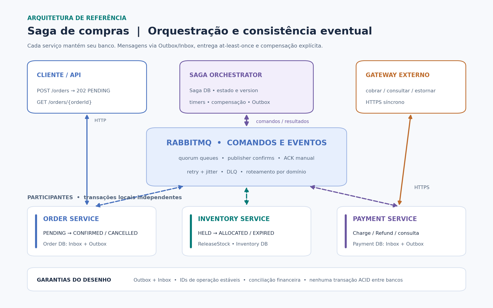
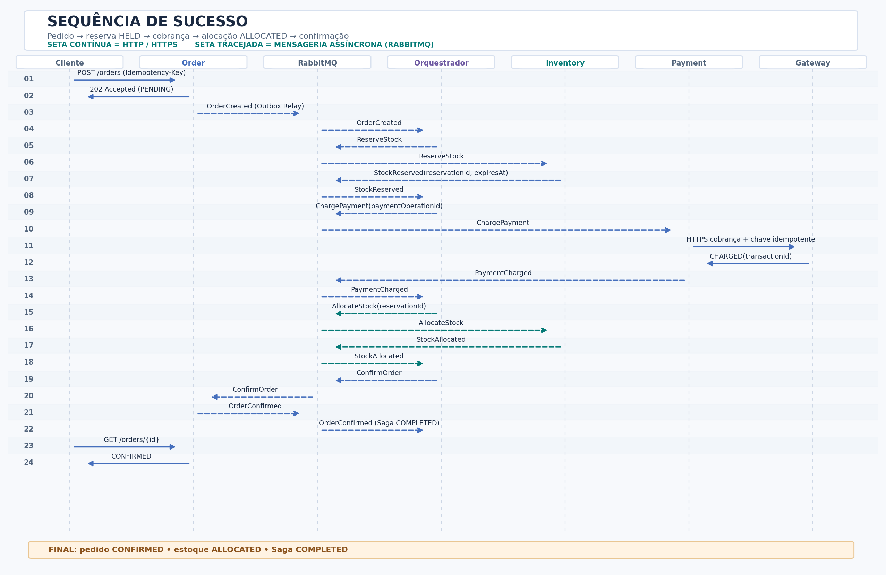
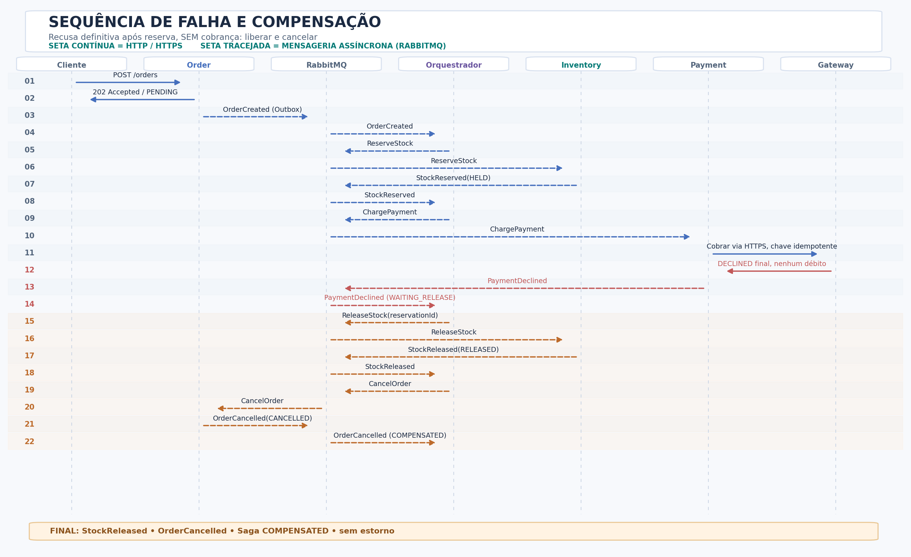
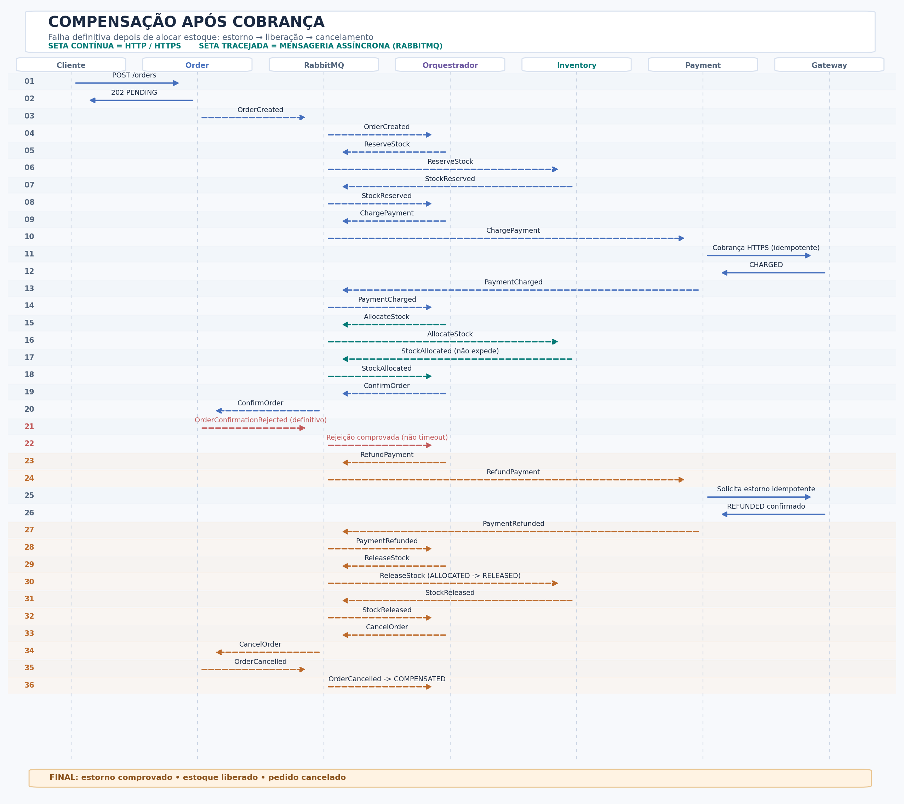
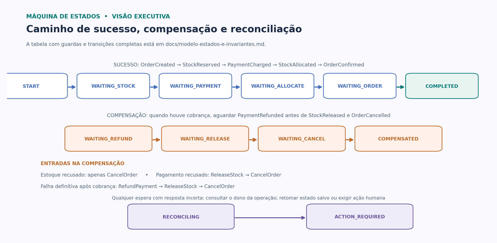

# Arquitetura de compras com o padrão Saga

## Visão geral

Este projeto apresenta a arquitetura do processo de compra de um e-commerce dividido em microsserviços. O ponto principal é manter pedido, estoque e pagamento consistentes, mesmo quando alguma dessas operações falha no meio do caminho.

A solução considera três serviços com bancos de dados independentes:

- **Order Service:** registra o pedido e acompanha sua situação até a confirmação ou o cancelamento.
- **Inventory Service:** verifica a disponibilidade dos itens, cria reservas temporárias e controla a alocação do estoque.
- **Payment Service:** processa cobranças e estornos por meio de um gateway de pagamento.

Como cada serviço grava seus próprios dados, não existe um único `ROLLBACK` capaz de desfazer uma compra inteira. Para resolver isso, o fluxo utiliza o **padrão Saga**: cada etapa faz uma transação local e, quando necessário, outras operações compensam aquilo que já foi realizado.

## Escolha da arquitetura

Optei pela **Saga por Orquestração**. Nesse modelo, um componente chamado `Saga Orchestrator` acompanha o andamento de cada compra e define qual serviço deve executar a próxima operação.

A Coreografia seria outra possibilidade: os próprios serviços reagiriam aos eventos uns dos outros, sem um coordenador central. Ela funciona bem em fluxos menores, mas o processo de compra precisa lidar com pagamento recusado, reservas que expiram, respostas atrasadas e estornos. Com a Orquestração, essas decisões ficam concentradas em um lugar, o que facilita entender e acompanhar cada pedido.

| Aspecto | Orquestração | Coreografia |
| --- | --- | --- |
| Comunicação | O orquestrador envia comandos e recebe resultados | Cada serviço reage aos eventos publicados pelos demais |
| Acoplamento | Dependência explícita do orquestrador e dos contratos | Dependências distribuídas entre produtores e consumidores de eventos |
| Complexidade | Exige um coordenador e controle de estados | Evita o coordenador, mas pode dificultar fluxos longos |
| Escalabilidade | Orquestrador e consumidores podem ter várias instâncias | Consumidores também podem escalar de forma independente |
| Falhas | Compensações e prazos acompanhados pelo orquestrador | Cada serviço participa das decisões de recuperação |

Essa escolha traz uma responsabilidade adicional: o orquestrador não pode perder o estado das Sagas quando reiniciar. Por isso, ele mantém suas informações em banco de dados e usa controle de concorrência para impedir que duas instâncias avancem o mesmo pedido ao mesmo tempo.

## Componentes e comunicação

A API de pedidos recebe a solicitação do cliente por HTTP. As operações entre os serviços acontecem principalmente por mensagens no **RabbitMQ**, separando o processamento de pedidos, estoque e pagamento. A comunicação do Payment Service com o gateway financeiro é feita por HTTPS.

Cada serviço utiliza seu próprio banco **PostgreSQL**. Também mantém uma **Outbox**, para registrar mensagens junto com a transação local, e uma **Inbox**, para reconhecer mensagens já processadas. Esses controles são importantes porque uma mensagem pode ser entregue mais de uma vez.

O orquestrador tem seu próprio banco, onde ficam o identificador da Saga, o pedido associado, a etapa atual, os prazos, as tentativas e os resultados recebidos.

## Compra concluída com sucesso

O processamento começa quando o cliente envia `POST /orders`. O Order Service registra o pedido como `PENDING` e retorna seu identificador. Enquanto isso, o evento `OrderCreated` dá início à Saga.

A partir daí, o fluxo segue esta ordem:

1. O orquestrador envia `ReserveStock`. O Inventory Service verifica a quantidade disponível, faz a reserva e retorna `StockReserved`.
2. Com o estoque reservado, o orquestrador envia `ChargePayment`. O Payment Service solicita a cobrança ao gateway e, quando ela é confirmada, retorna `PaymentCharged`.
3. O orquestrador solicita `AllocateStock`. Essa operação transforma a reserva temporária (`HELD`) em estoque alocado (`ALLOCATED`). A validação ocorre dentro de uma transação local, para impedir que uma reserva expirada seja aproveitada.
4. Depois de receber `StockAllocated`, o orquestrador envia `ConfirmOrder`.
5. O Order Service grava `CONFIRMED` e publica `OrderConfirmed`. Nesse momento, a Saga passa para `COMPLETED`.

A alocação do estoque acontece antes da confirmação do pedido porque uma reserva temporária pode vencer enquanto o pagamento está sendo processado. Mesmo depois de `StockAllocated`, a expedição só deve ser liberada quando o pedido estiver confirmado.

## Falha no pagamento e compensação

Considere uma compra em que o produto foi reservado, mas o cartão foi recusado pelo gateway. Nesse caso, o pagamento não foi realizado, porém a reserva já afetou a quantidade disponível no estoque.

O Payment Service publica `PaymentDeclined` quando recebe uma recusa definitiva. O orquestrador então executa as compensações na seguinte sequência:

1. Envia `ReleaseStock` ao Inventory Service.
2. Aguarda `StockReleased`, que confirma a liberação da reserva.
3. Envia `CancelOrder` ao Order Service.
4. Aguarda `OrderCancelled` e encerra a Saga com o estado `COMPENSATED`.

Não há estorno financeiro nesse fluxo porque o pagamento foi recusado e não houve cobrança. A liberação de estoque e o cancelamento do pedido são as operações compensatórias necessárias.

## Falha depois de uma cobrança aprovada

Uma situação diferente ocorre quando a cobrança é aprovada, mas o pedido não pode ser concluído. Isso pode acontecer, por exemplo, se a reserva expirar antes da alocação ou se a confirmação do pedido for rejeitada definitivamente.

Nesse caso, o orquestrador solicita `RefundPayment` e espera a confirmação `PaymentRefunded`. Depois, libera o estoque, quando aplicável, e cancela o pedido. Uma resposta `RefundPending` indica que o estorno ainda está em processamento e não permite encerrar a compensação como concluída.

Também é importante diferenciar uma falha real de um **timeout**. Se o Payment Service não receber resposta do gateway, isso não significa que o cartão não foi cobrado. Antes de repetir a operação, o serviço precisa consultar a transação usando o mesmo identificador de pagamento. A mesma lógica vale para `ConfirmOrder`: o pedido pode ter sido confirmado mesmo que o evento tenha atrasado.

## Estados e regras de consistência

Os estados de cada serviço são independentes, mas precisam respeitar algumas regras comuns:

| Componente | Estados principais | Regra |
| --- | --- | --- |
| Pedido | `PENDING`, `CONFIRMED`, `CANCELLED` | Só confirmar após pagamento aprovado e estoque alocado |
| Estoque | `HELD`, `ALLOCATED`, `RELEASED`, `EXPIRED` | Uma reserva expirada não pode ser alocada |
| Pagamento | `PENDING`, `UNKNOWN`, `DECLINED`, `CHARGED`, `REFUND_PENDING`, `REFUNDED` | Resultado desconhecido exige consulta, não nova cobrança automática |
| Saga | Espera, compensação, reconciliação e conclusão | Uma etapa só avança quando o resultado anterior foi confirmado |

O estado `RECONCILING` é usado quando há alguma operação com resultado incerto. Se a recuperação automática não resolver a situação, o caso passa para `ACTION_REQUIRED` e precisa de acompanhamento. O detalhamento das transições está em [modelo de estados e invariantes](docs/modelo-estados-e-invariantes.md).

## Tratamento de falhas

A arquitetura combina alguns mecanismos de resiliência:

- **Idempotência:** a mesma solicitação não pode gerar duas reservas, cobranças ou liberações de estoque.
- **Transactional Outbox e Inbox:** permitem publicar mensagens de forma confiável e lidar com entregas duplicadas.
- **Retry com backoff:** repete operações técnicas transitórias com limite de tentativas. Uma recusa definitiva de cartão não deve ser repetida.
- **Circuit Breaker:** protege a integração com o gateway quando ele apresenta falhas técnicas repetidas.
- **Dead-Letter Queue (DLQ):** separa mensagens que não puderam ser processadas e facilita a investigação.
- **Reconciliação:** consulta o estado real dos serviços quando uma resposta demora, se perde ou é contraditória.

As compensações também são idempotentes. Se `ReleaseStock` chegar duas vezes, por exemplo, o Inventory Service deve reconhecer que aquela reserva já foi liberada, sem devolver a quantidade ao estoque novamente.

Os contratos de mensagens, a matriz de idempotência e as decisões sobre falhas estão detalhados nos documentos abaixo.

## Documentação

| Arquivo | Conteúdo |
| --- | --- |
| [Decisões arquiteturais](docs/decisoes-arquiteturais.md) | Escolhas técnicas, riscos, mensageria, Retry, Circuit Breaker e DLQ |
| [Contratos de mensagens](docs/contratos-mensagens.md) | Comandos, eventos, identificadores e exemplos de comunicação |
| [Idempotência e timeouts](docs/matriz-idempotencia-e-timeouts.md) | Reações a mensagens duplicadas, respostas perdidas e timeouts |
| [Estados e invariantes](docs/modelo-estados-e-invariantes.md) | Condições para avançar, compensar e concluir uma Saga |
| [Cenários de validação](docs/casos-de-teste.md) | Situações usadas para conferir o comportamento esperado do fluxo |

Os arquivos editáveis dos diagramas estão em [`diagrams/`](diagrams/), nos formatos Mermaid (`.mmd`) e PlantUML (`.puml`), além das versões PNG e SVG.

## Referências

- RICHARDSON, Chris. [Saga](https://microservices.io/patterns/data/saga.html). Microservices.io.
- RICHARDSON, Chris. [Transactional Outbox](https://microservices.io/patterns/data/transactional-outbox.html). Microservices.io.
- RICHARDSON, Chris. [Idempotent Consumer](https://microservices.io/patterns/communication-style/idempotent-consumer.html). Microservices.io.
- RABBITMQ. [Quorum Queues](https://www.rabbitmq.com/docs/quorum-queues) e [Dead Letter Exchanges](https://www.rabbitmq.com/docs/dlx).
- AMAZON WEB SERVICES. [Timeouts, retries, and backoff with jitter](https://aws.amazon.com/builders-library/timeouts-retries-and-backoff-with-jitter/).
- MICROSOFT. [Circuit Breaker pattern](https://learn.microsoft.com/en-us/azure/architecture/patterns/circuit-breaker).
- STRIPE. [Idempotent requests](https://docs.stripe.com/api/idempotent_requests).
